# Restofy — ER Diyagramları

**Tarih:** 15 Ekim 2026. Kaynak: nihai gereksinim Word belgesi ve repository.  
**Durum:** Önerilen hedef veri modeli; mevcut üretim şeması değildir. Üretim entity/migration bulunmadığı için diyagramlar reverse engineering çıktısı olarak sunulmaz.

Alanların ayrıntısı, NULL kuralları, türler, tenant kısıtları ve indeksler [database.md](database.md) içinde; iş kuralları [requirements.md](requirements.md), servis akışları [architecture.md](architecture.md) içindedir.

## 1. Okuma kuralları

- Mermaid `erDiagram` kullanılmıştır. GitHub veya Mermaid destekli Markdown görüntüleyiciyle çizilebilir; düz metin editörü kodu gösterir.
- `||` tam bir, `o|` sıfır/bir, `o{` sıfır/çok, `|{` bir/çok anlamındadır.
- `PK` fiziksel birincil anahtar, `FK` yalnız aynı servis DB'sindeki fiziksel ilişkidir. Şemalardaki `UK` tek kolon tekilliğini özetler; bileşik/kısmi tekillikler database.md'de açıklanır.
- `REF` etiketli ilişki başka servis kimliğidir: SQL FK veya veritabanları arası JOIN değildir. İlk genel şemadaki bütün ilişkiler kavramsaldır.
- Okunabilirlik için created_at/updated_at/version ve bazı snapshot alanları her kutuda gösterilmemiştir. Bu dosya tüm DDL'nin yerine geçmez.
- İş tablolarındaki restaurant_id, sahip Admin dışındaki DB'lerde mantıksal tenant referansıdır. Yerel parent/child bağlantıları ayrıca tenant bileşik FK ile korunmalıdır.

## 2. Servisler arası kavramsal model

**Bu bölümdeki çizgilerin hiçbiri servisler arası fiziksel FK değildir.** Kutulardaki önek servis sahibini gösterir; aşağıdaki yerel şemalarda gerçek önerilen tablo adları kullanılır.

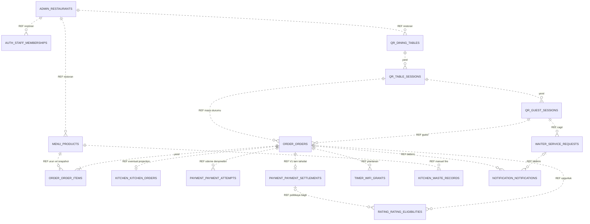

Order → Kitchen sıfır/bir gösterilir: olay henüz ulaşmamış olabilir; aynı orderId için ikinci mutfak kaydı oluşamaz. Ödeme denemesi çok, V1 başarılı gerçek settlement en çok birdir. Bölüşme/iade dahil değildir. Wi-Fi için çokluk ürün politikası belirlenmeden tek cihaza sınır koymamak amacıyla kavramsaldır.

## 3. Admin DB

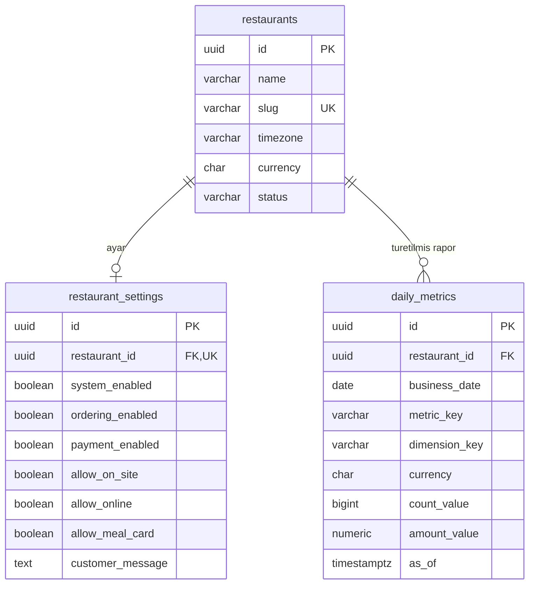

daily_metrics yeniden üretilebilir rapor projeksiyonudur. Boyut ve para birimi tekilliği database.md'de tanımlıdır; operasyonel iş gerçeği değildir.

## 4. Auth DB

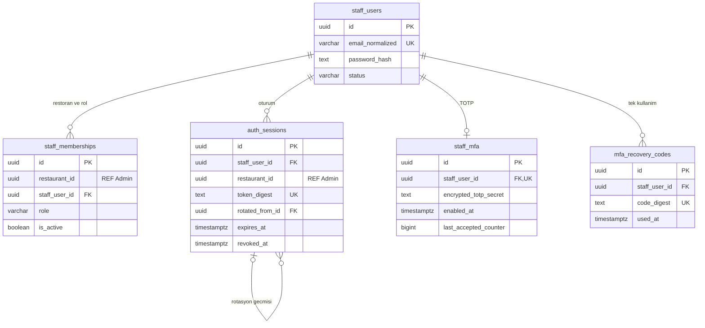

Personel global kimlik, üyelik restoran bazlıdır. staff_users üzerinde restaurant_id olmaması restoran sınırlarının kaldırıldığı anlamına gelmez. Auth yöntemi ve TOTP sözleşmesi henüz uygulanmamıştır.

## 5. QR DB

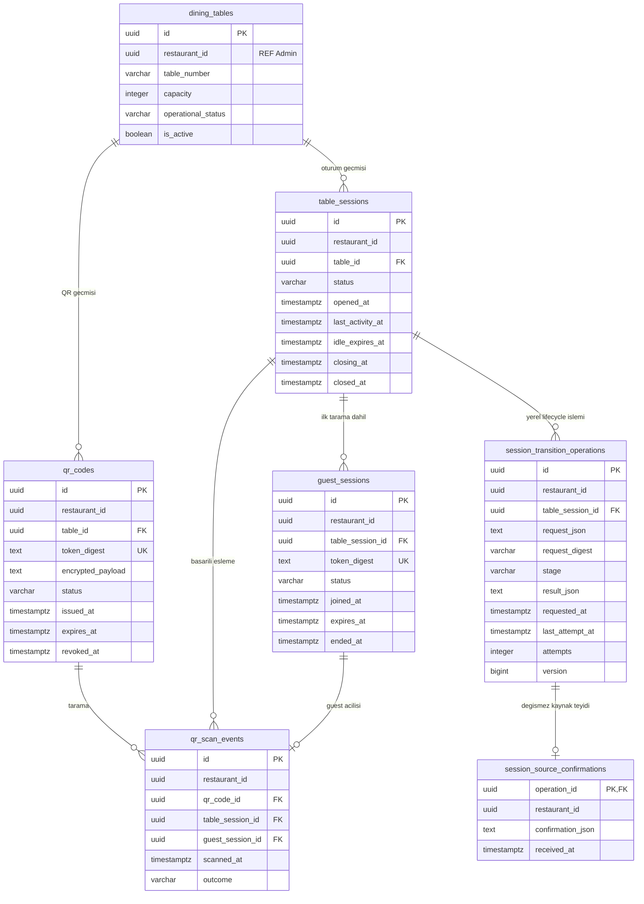

Tarihsel olarak bir masanın çok oturumu olabilir; aynı anda OPEN/CLOSING en fazla birdir ve kısmi unique indeksle korunur. ADR-QR-001/A/K13 uyarınca QR sipariş/finans projeksiyonu tutmaz. V29/V30 yerel lifecycle komut/sonucunu, V121 kaynak ACK/sapma makbuzunu tutar; bir işlemde en fazla bir kaynak teyidi vardır. Geçmiş ve teyitler değişmezdir. Gerçek Order/Payment ağ adaptörleri henüz uygulanmadı; diyagram bunları tamamlanmış saymaz.

## 6. Menu DB

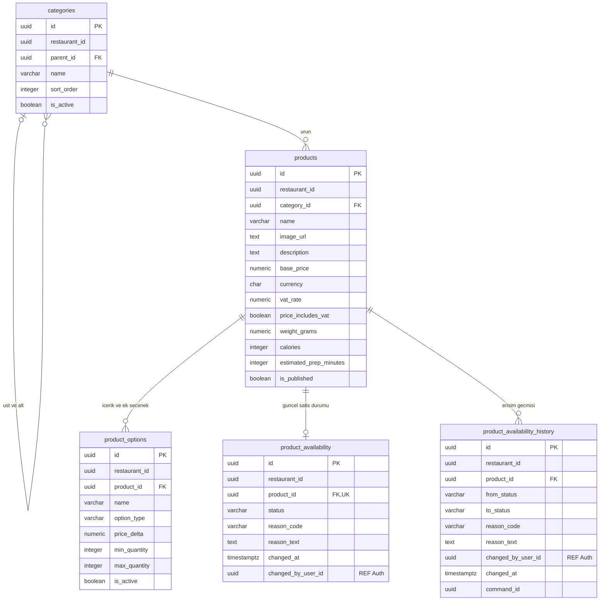

Satışa sunulan ürün için availability kaydı oluşturulması application transaction'ında zorunlu önerilir. Modelde 0/1, henüz satışa açılmamış ürün taslağına izin verir; availability bulunmaması satış izni sayılmaz. Kitchen kapatma komutunun yazarı Menu'dür. Otomatik restart açılışı yoktur. product_options hammadde stok tablosu değildir.

## 7. Order DB

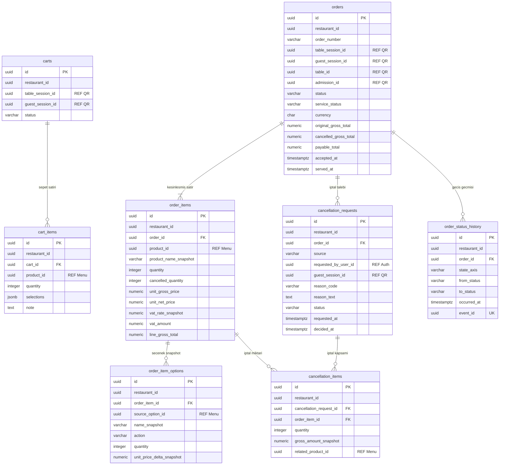

İptal satırı talebin siparişiyle aynı order'a ait olmalıdır; yalnız iki bağımsız FK bunu garanti etmez. Ek bileşik anahtar/transaction validation gerekir. Tam iptal tüm kalan miktarları kapsar. Kısmi iptalin Kitchen V1'e yansıması açık karardır. Sepet kesinleşmiş siparişin yerine geçmez; menü fiyat güncellemesi snapshot'ı değiştirmez.

## 8. Kitchen DB

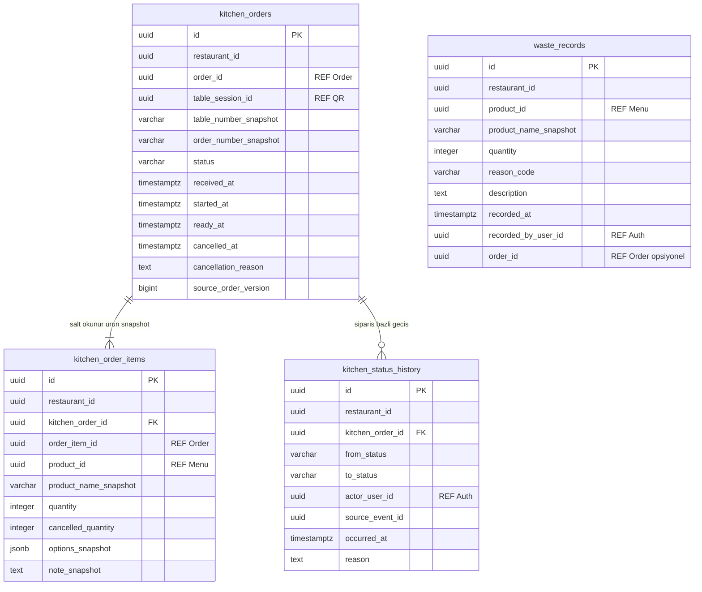

Fire her zaman siparişe bağlı değildir; waste_records bu nedenle yerel kitchen_orders FK'si taşımaz. kitchen_order_items üzerinde hazırlık durumu yoktur. V1 WAITING → PREPARING → READY; iptal Order onayıyla. Ürün kapatma gerçeği Menu DB'sindedir, ikinci availability tablosu Kitchen'da oluşturulmaz.

## 9. Waiter DB

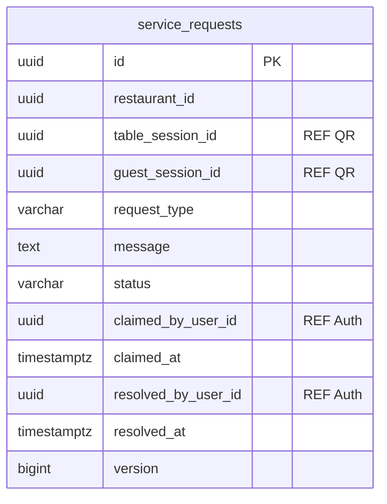

Tek yerel iş tablosu başlangıç için yeterlidir; masa ve sipariş burada kopya otorite olarak tutulmaz. Teslim Order, ana oturum kapanışı QR işlemidir. Garson ekranı gerekli projeksiyonları API/olaydan alır.

## 10. Payment DB

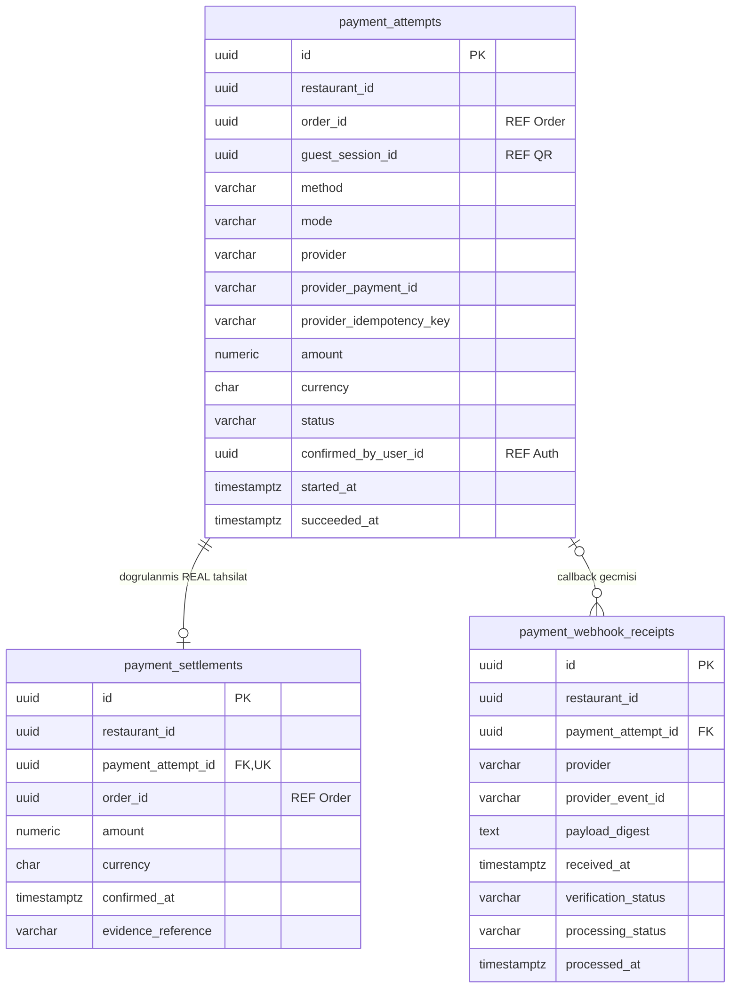

`UNIQUE(restaurant_id,order_id)` settlement için V1 tam ödeme kısıtıdır. Bölüşme/iade modeli değildir. Callback imza/merchant eşlemesiyle tenant belirlenir; belirsiz/gecikmiş sonuç kaybolmaz. DEMO başarı gerçek settlement veya ciro oluşturmaz.

## 11. Rating DB

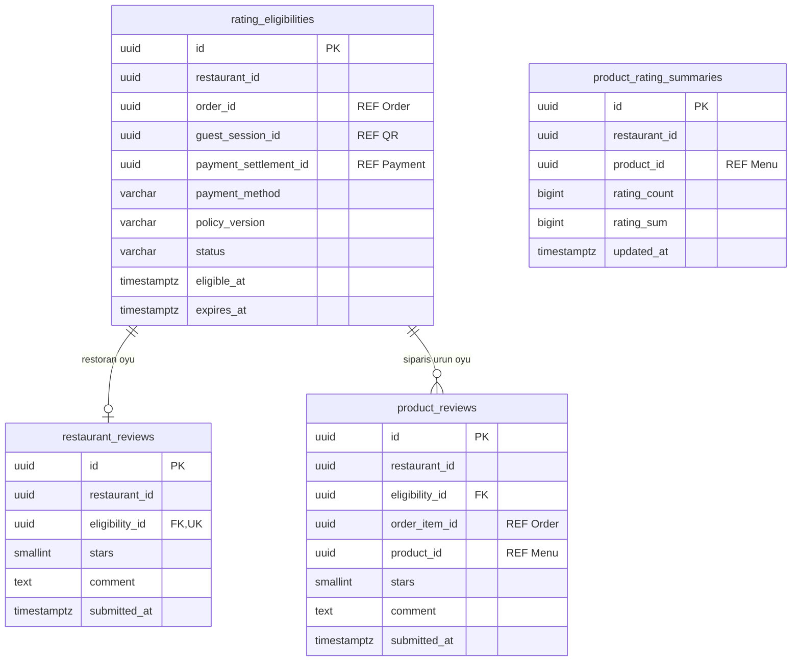

Rating summary product_id üzerinden mantıksal olarak gruplanır; product_reviews tablosuna fiziksel FK değildir. Yıldız 1..5; guest/sipariş/ürün sahipliği ayrıca doğrulanır. Nakit değerlendirme ve kapanmış guest sonrası sınırlı erişim politikaları açıktır.

## 12. Notification DB

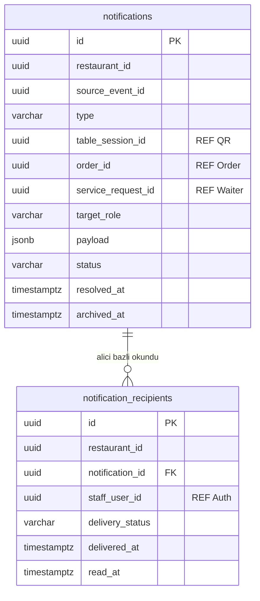

Bildirim okuma alıcı bazlıdır; iş çağrısının çözümü Waiter olayıyla gelir. Masa kapanışında arşivleme geçmişi silmez.

## 13. Mail DB ve planlanan Timer DB

Bu iki kutu grubu ayrı veritabanlarıdır; aralarında fiziksel ilişki yoktur.

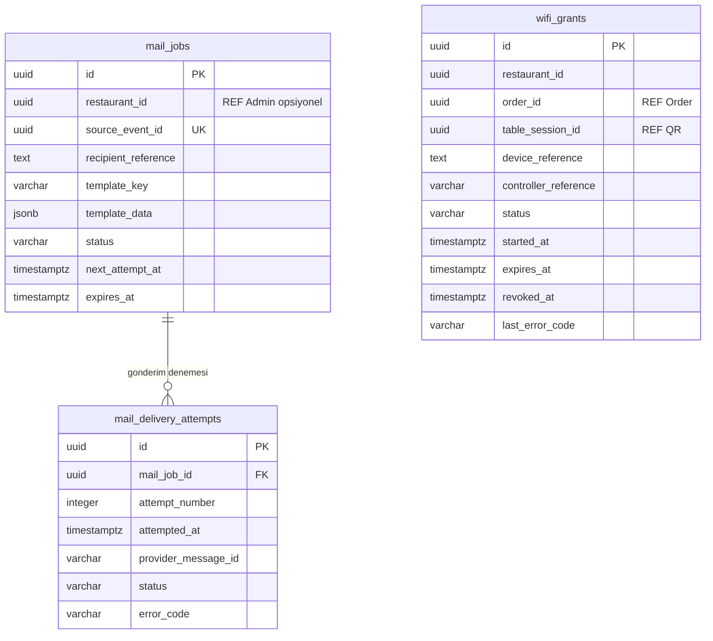

Wi-Fi timer planlanmıştır; controller entegrasyonu tanımsızdır. Üç saat sonunda expires_at geçmesi erişimin gerçekten kesildiğini kanıtlamaz. Mail template verisi sır içeriyorsa kısa süreli/şifreli tutulmalı ve loglanmamalıdır.

## 14. Teknik tablolar — ihtiyaç duyan her servis DB'sinde

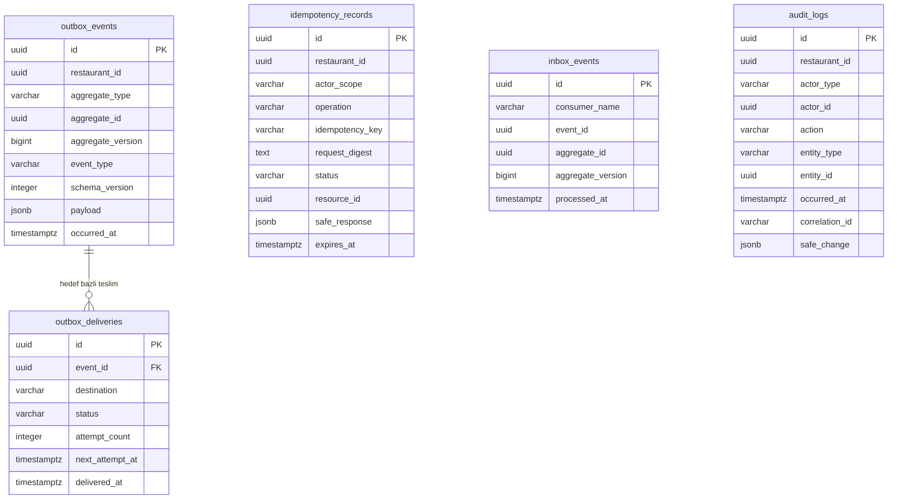

Inbox.event_id üreticinin başka DB'deki outbox'una fiziksel FK değildir. Tekillik `(consumer_name,event_id)` ile uygulanır. Outbox teslimi `(event_id,destination)` bazındadır. Idempotency anahtarı tenant + actor + operation scope'uyla tekildir. Flyway history bu teknik modelin dışında Flyway tarafından yönetilir.

## 15. Modelin garanti etmesi gereken kurallar

1. Bir masada aynı anda tek OPEN/CLOSING ana oturum; ilk dahil tüm taramalar guest'e bağlıdır.
2. Guest, oturum ve yerel çocuk satırları aynı tenant/ebeveyn zincirine aittir.
3. Aynı orderId tek Kitchen kaydı; item başına hazırlık durumu yoktur.
4. Kitchen iptal talebi Order kesin kararıyla ayrıdır; READY teslim sonrası değişmez.
5. Availability tek otoritede kalıcıdır; restart otomatik açmaz.
6. Sipariş ürün/fiyat/vergi/seçenek snapshot'ı geçmişi korur; iptal orijinal miktarı geçmez.
7. V1 tek gerçek settlement/order; tekrar callback veya belirsiz timeout çift tahsilat üretmez.
8. Çağrı okundu/çözüldü farklıdır; bildirim alıcı bazlı okunur.
9. 15 dakika idle, ödeme/masa kapanışı ve üç saat Wi-Fi ayrı yaşam döngüleridir.
10. Çizgiler tek başına transaction, authorization, yarış kontrolü veya olay teslim garantisi sağlamaz. Kısıtlar ve servis protokolü birlikte uygulanmalıdır.

Bu diyagramlar Markdown kaynak düzeyinde hazırlanmıştır; Mermaid görsel render doğrulaması bu incelemede yapılmamıştır.
